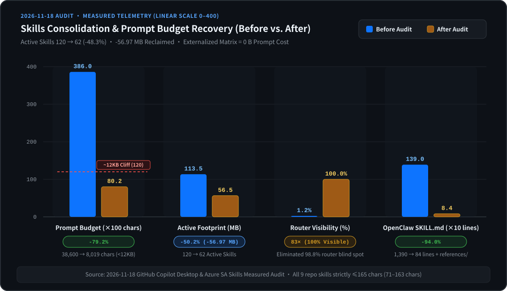

# Azure SA Skills

> [中文版 (`README.md`)](./README.md) · **Harness Co-Evolution Guide**: [English (`docs/harness-coevolution/README.en.md`)](./docs/harness-coevolution/README.en.md) | [中文 (`README.md`)](./docs/harness-coevolution/README.md) · [Interactive Visual Report](https://turbo998.github.io/workshops/agent-harness-coevolution/index.en.html)

A collection of GitHub Copilot and Hermes skills for daily Azure Solution Architect (SA) workflows. Each subdirectory is a self-contained skill with a compact-frontmatter `SKILL.md`, progressive-disclosure `references/`, and standalone scripts or templates.

## Skills

### Partner-Facing & Customer Delivery

- [`billing-assistant/`](./billing-assistant/) — Anchor-based PyMuPDF toolkit that rewrites raw partner/CSP billing PDFs (with markup annotations) into customer-ready invoices while preserving layout, supporting dual currencies, auto-resolving CJK fonts across Windows/macOS/Linux, and stripping annotations without LLM hallucination.
- [`openclaw-wechat-deployment/`](./openclaw-wechat-deployment/) — Progressive-disclosure runbook (`SKILL.md` + `references/`) for deploying OpenClaw on Azure Ubuntu 24.04 with GitHub Copilot frontier models (`gpt-6.2-sol`, `gemini-4-carbon`, `grok-4.7`, `gemini-3.8-flash`), AFD/Caddy HTTPS, and WeChat QR integration.
- [`wechat-article/`](./wechat-article/) — Converts technical notes or Markdown into inline-styled HTML articles formatted for WeChat Official Accounts.

### Azure / Hermes Infrastructure

- [`azure-hermes-ghcp-wechat/`](./azure-hermes-ghcp-wechat/) — Deploys NousResearch Hermes Agent on an Azure Linux VM, configures GitHub Copilot frontier models (`gpt-6.2-sol` / `gemini-4-carbon` / `grok-4.7`), and connects personal WeChat/Weixin via QR login.
- [`azure-foundry-quota-tier/`](./azure-foundry-quota-tier/) — Quick lookup and diagnostics for Azure AI Foundry / Azure OpenAI subscription quota tiers (Tier 1–6), TPM limits, and upgrade paths.
- [`chorus-azure-deployment/`](./chorus-azure-deployment/) — Deploys [Chorus-AIDLC/Chorus](https://github.com/Chorus-AIDLC/Chorus) to Azure Container Apps at minimum cost (Bicep IaC, embedded PGlite, `emptyDir` vs. `azureFile`, MCAPS shared-key workarounds).

### Presentation / Templates & Knowledge Animation

- [`azure-style-presentation/`](./azure-style-presentation/) — Self-contained single-file HTML slide presentations built with Microsoft Azure visual design language.
- [`ppt-template-strict-offering/`](./ppt-template-strict-offering/) — Zero-drift PowerPoint generation workflow that strictly replaces text slots inside an existing reference `.pptx` offering template.
- [`one-sentence-video/`](./one-sentence-video/) — Autopilot HyperFrames motion-graphics video production skill featuring a 7-step pipeline, 23 4-axis style presets, 22 measured shot cards, procedural Python BGM/SFX synthesis, dual-layer quality gates, and 3 benchmark knowledge-explainer templates (*Xiaozhe MCP Node Graph*, *Xiaozhe RAG Pipeline Flow*, and *Chimp DeepSeek Unit Economics*).
  - 中文说明: [`one-sentence-video/README.md`](./one-sentence-video/README.md) | English: [`one-sentence-video/README.en.md`](./one-sentence-video/README.en.md)

---

## Frontier Model Routing

All skills in this repository are aligned with current frontier model registrations (use `github-copilot/<model-id>` in OpenClaw, or `<model-id>` directly in GitHub Copilot CLI/App and Hermes `copilot` provider):

| Model ID | Strengths & Role | Recommended Skills & Workloads |
|---|---|---|
| `gpt-6.2-sol` | Default engineering & multi-step agentic workhorse; highest reliability on tool orchestration, IaC, and structured codegen | `openclaw-wechat-deployment`, `azure-hermes-ghcp-wechat`, `chorus-azure-deployment`, `ppt-template-strict-offering`, `one-sentence-video` frame synthesis |
| `gemini-4-carbon` | Native multimodal visual inspection & long-context synthesis | `billing-assistant` (rendered PNG invoice verification via `view`), `one-sentence-video` (3-direction style bakeoff & frame inspection), `azure-style-presentation`, long-doc `wechat-article` |
| `grok-4.7` | Low-latency conversational turnaround, fast triage & second-opinion reasoning | Interactive WeChat gateway chat (OpenClaw / Hermes), `azure-foundry-quota-tier` rapid diagnostics, cross-model plan/code verification |

> For high-throughput background checks or lightweight Q&A, pair with `gemini-3.8-flash`. Always verify live account entitlement via `openclaw models list` or `hermes model`.

---

## Skill & Agent Harness Co-Evolution Governance Guide

As frontier models advance to `gpt-6.2-sol`, `gemini-4-carbon`, and `grok-4.7`, an agent harness must continuously **subtract obsolete scaffolding and tighten deterministic invariants** to prevent `<available_skills>` router truncation and context pollution. Under [`docs/harness-coevolution/`](./docs/harness-coevolution/), we document the **5 practical co-evolution rules and case studies** proven in our 2026-11-18 audit (`120 → 62` active skills, `-79.2%` `<available_skills>` XML payload, `1.2% → 100%` router visibility, `-94%` progressive disclosure on `openclaw-wechat-deployment`, and deterministic PyMuPDF + multimodal vision QA):

- **Bilingual Governance Guide & Visual Case Studies**: [English (`docs/harness-coevolution/README.en.md`)](./docs/harness-coevolution/README.en.md) | [中文版 (`docs/harness-coevolution/README.md`)](./docs/harness-coevolution/README.md)
- **2026 Frontier Model × SA Skill Routing Matrix & Checklist**: [`docs/harness-coevolution/MODEL-SKILL-MATRIX.md`](./docs/harness-coevolution/MODEL-SKILL-MATRIX.md)
- **Live Interactive Presenter Showcase**: [English (`index.en.html`)](https://turbo998.github.io/workshops/agent-harness-coevolution/index.en.html) | [中文版 (`index.html`)](https://turbo998.github.io/workshops/agent-harness-coevolution/index.html)
- **Full Research Monograph**: [`ai-research-public/docs/research/agent-harness-model-coevolution`](https://github.com/turbo998/ai-research-public/tree/main/docs/research/agent-harness-model-coevolution)

---

## Usage

**As a GitHub Copilot skill (CLI / App)**: Copy or symlink individual skill directories into `~/.copilot/skills/<skill-name>/` (Windows: `%USERPROFILE%\.copilot\skills\<skill-name>\`). Every `SKILL.md` keeps its YAML frontmatter `description` within `≤165` characters to fit Copilot's `<available_skills>` prompt budget cleanly.

**As a Hermes skill**: Clone this repository into `~/.hermes/profiles/<profile>/skills/` or copy an individual skill directory there, then load via `skill_view(name='<skill-name>')`.

**As standalone scripts**: Run the tools in each skill's `scripts/`, `assets/`, or `templates/` directory directly.
