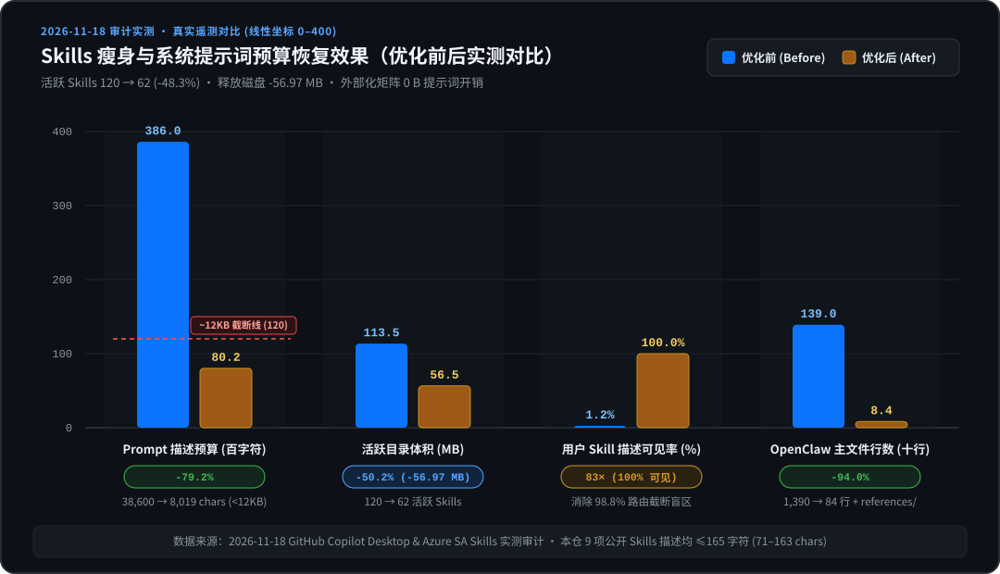

# Azure SA Skills

> [English Version (`README.en.md`)](./README.en.md) · **Harness 演进治理指南**: [中文 (`docs/harness-coevolution/README.md`)](./docs/harness-coevolution/README.md) | [English (`README.en.md`)](./docs/harness-coevolution/README.en.md) · [交互式图文报告 (Live Showcase)](https://turbo998.github.io/workshops/agent-harness-coevolution/index.html)

Azure SA（Solution Architect）日常工作相关的 GitHub Copilot / Hermes skills 集合。每个子目录是一个独立 skill，含精简 frontmatter 的 `SKILL.md`、按需加载的 `references/` 以及可独立运行的脚本/模板。

## Skills

### 客户交付 / Partner-facing

- [`billing-assistant/`](./billing-assistant/) — Anchor-based PyMuPDF 工具，把合作伙伴/CSP 寄来的原始账单 PDF（含批注修改要求）改写为客户成品账单，保留版式、支持双币种与跨平台（Windows/macOS/Linux）中文字体自动解析、自动剥除批注。无 LLM 幻觉风险。
- [`openclaw-wechat-deployment/`](./openclaw-wechat-deployment/) — OpenClaw on Azure Ubuntu 24.04 部署手册（渐进式披露 `SKILL.md` + `references/`），配置 GitHub Copilot 前沿模型（`gpt-6.2-sol`、`gemini-4-carbon`、`grok-4.7`、`gemini-3.8-flash`）、AFD/Caddy HTTPS 与个人微信扫码。
- [`wechat-article/`](./wechat-article/) — 把技术笔记或 Markdown 转成内联样式的微信公众号 HTML 文章。

### Azure / Hermes infra

- [`azure-hermes-ghcp-wechat/`](./azure-hermes-ghcp-wechat/) — 在 Azure Linux VM 上部署 Hermes Agent，配置 GitHub Copilot 模型（`gpt-6.2-sol` / `gemini-4-carbon` / `grok-4.7`）并扫码接入个人微信。
- [`azure-foundry-quota-tier/`](./azure-foundry-quota-tier/) — Azure AI Foundry / Azure OpenAI 订阅配额与 Tier（Tier 1–6）排查速查。
- [`chorus-azure-deployment/`](./chorus-azure-deployment/) — [Chorus-AIDLC/Chorus](https://github.com/Chorus-AIDLC/Chorus) 最低成本部署到 Azure Container Apps（Bicep IaC、内嵌 PGlite、`emptyDir` vs `azureFile`、MCAPS shared-key 策略绕过）。

### Presentation / 模板 & 知识动画

- [`azure-style-presentation/`](./azure-style-presentation/) — 微软 Azure 视觉设计语言的单文件自包含 HTML 演示文稿。
- [`ppt-template-strict-offering/`](./ppt-template-strict-offering/) — 严格遵循既有 `.pptx` 模板版式、零漂移替换文本槽位的客户/伙伴方案 PPT 流程。
- [`one-sentence-video/`](./one-sentence-video/) — 一句话生成 HyperFrames 程序化动画视频的自动驾驶 Skill（含 7 步流水线、23 套四轴风格账本、22 张测量级镜头卡、BGM/SFX 合成器与双层质量门禁，内置小哲讲 Agent/RAG 与第四种黑猩猩算力经济学 3 套知识讲解标杆模板）。
  - 中文说明：[`one-sentence-video/README.md`](./one-sentence-video/README.md) | English: [`one-sentence-video/README.en.md`](./one-sentence-video/README.en.md)

---

## 前沿模型路由（Frontier Model Routing）

本仓库所有 Skills 均已针对当前主力前沿模型对齐测试与配置（在 OpenClaw 中使用 `github-copilot/<model-id>`，在 Hermes `copilot` provider 或 GitHub Copilot CLI/App 中直接使用 `<model-id>`）：

| 模型 ID | 定位与优势 | 典型适用 Skills / 场景 |
|---|---|---|
| `gpt-6.2-sol` | 默认工程与多步 Agent 主力；工具调用、IaC、代码与精确结构生成最稳 | `openclaw-wechat-deployment`、`azure-hermes-ghcp-wechat`、`chorus-azure-deployment`、`ppt-template-strict-offering`、`one-sentence-video` 帧代码合成 |
| `gemini-4-carbon` | 原生多模态视觉理解 + 超长上下文综合 | `billing-assistant`（改后 PDF 渲染 PNG 视觉核验）、`one-sentence-video`（三方向审美样帧与抽帧质检）、`azure-style-presentation`、长文档转 `wechat-article` |
| `grok-4.7` | 低延迟对话交互、快速推理与实时分流 | 微信网关日常即时问答（OpenClaw / Hermes）、`azure-foundry-quota-tier` 快速诊断、方案与代码二阶交叉审阅 |

> 轻量高吞吐后台探针或简单问答可搭配 `gemini-3.8-flash`。部署后建议通过 `openclaw models list` 或 `hermes model` 校验当前账号实时可用模型列表。

---

## Skill & Agent Harness 随模型升级协同演进指南（Governance & Case Studies）

随着前沿模型迭代至 `gpt-6.2-sol`、`gemini-4-carbon` 与 `grok-4.7`，Agent Harness 需要持续做**「减法与边界收敛」**，避免历史提示词堆积引发 `<available_skills>` 路由截断失明与上下文污染。我们在 [`docs/harness-coevolution/`](./docs/harness-coevolution/) 中沉淀了 **2026-11-18 全量实测审计与五条实战治理法则**（活跃 Skills `120 → 62`、`<available_skills>` 提示词预算 `-79.2%`、用户 Skill 路由可见率 `1.2% → 100%`、`openclaw-wechat-deployment` 主干 `-94%` 渐进式披露、确定性 PyMuPDF 锚点 + 多模态视觉质检）：

- **实战治理指南（图文版）**：[中文指南 (`docs/harness-coevolution/README.md`)](./docs/harness-coevolution/README.md) | [English Guide (`docs/harness-coevolution/README.en.md`)](./docs/harness-coevolution/README.en.md)
- **前沿模型 × SA Skills 路由矩阵与编写清单**：[`docs/harness-coevolution/MODEL-SKILL-MATRIX.md`](./docs/harness-coevolution/MODEL-SKILL-MATRIX.md)
- **交互式技术宣讲演示页（Live Showcase）**：[中文版 (`index.html`)](https://turbo998.github.io/workshops/agent-harness-coevolution/index.html) | [English (`index.en.html`)](https://turbo998.github.io/workshops/agent-harness-coevolution/index.en.html)
- **专题研究报告（Monograph）**：[`ai-research-public/docs/research/agent-harness-model-coevolution`](https://github.com/turbo998/ai-research-public/tree/main/docs/research/agent-harness-model-coevolution)

---

## 用法

**作为 GitHub Copilot Skill（CLI / App）**：将单个 skill 子目录复制或链接到 `~/.copilot/skills/<skill-name>/`（Windows：`%USERPROFILE%\.copilot\skills\<skill-name>\`）。所有 `SKILL.md` 的 YAML frontmatter `description` 均控制在 `≤165` 字符内，契合 Copilot `<available_skills>` 路由预算与渐进式披露规范。

**作为 Hermes Skill**：将本仓库 clone 到 `~/.hermes/profiles/<profile>/skills/` 下，或把单个目录复制过去，通过 `skill_view(name='<skill-name>')` 加载。

**作为参考脚本**：每个 skill 目录下都有可独立运行的 `scripts/`、`assets/` 或 `templates/`。
