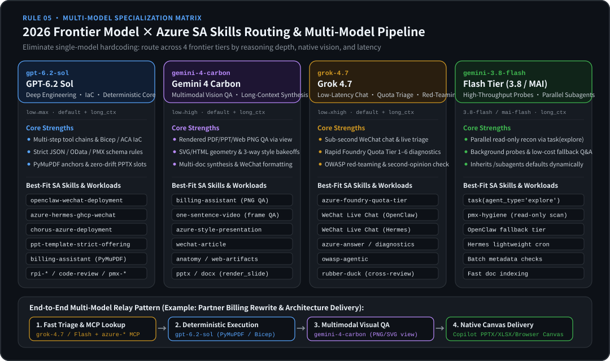

# 2026 Frontier Model × Azure SA Skill Routing Matrix & Authoring Checklist
# 2026 前沿模型 × Azure SA Skills 路由矩阵与编写规范清单

> **Governance Guides**: [中文指南 (`README.md`)](./README.md) · [English Guide (`README.en.md`)](./README.en.md) · **Live Showcase**: [中文](https://turbo998.github.io/workshops/agent-harness-coevolution/index.html) / [EN](https://turbo998.github.io/workshops/agent-harness-coevolution/index.en.html)
>
> **Local Placement Tip (`0-Byte` Prompt Cost)**: Copy this file to `~/.copilot/MODEL-SKILL-MATRIX.md` (**outside** `~/.copilot/skills/`) so operators and skill authors can reference it without consuming a single byte of Copilot's `<available_skills>` XML system-prompt budget.

---

## 1. Frontier Model Cohort & Provider Identifiers / 主力前沿模型登记表

Use `<model-id>` directly in **GitHub Copilot CLI / Desktop App** and **Hermes (`copilot` provider)**, or `github-copilot/<model-id>` in **OpenClaw**. Always confirm live account entitlement via `openclaw models list` or `hermes model`.

| Model ID (`<model-id>`) | OpenClaw ID | Reasoning Efforts | Context Tiers | Primary Role & Architectural Sweet Spot / 核心定位与适用负载 |
|---|---|---|---|---|
| **`gpt-6.2-sol`** | `github-copilot/gpt-6.2-sol` | `low`, `medium`, `high`, `xhigh`, `max` | `default`, `long_context` | **Default Engineering & Deterministic Workhorse**: Multi-step tool orchestration, Azure Bicep/Terraform/ACA IaC, strict JSON/OData/CRM compliance, deterministic PyMuPDF & OOXML code synthesis. **默认工程与确定性执行主力**：复杂多步工具链、云基础设施代码、严格 Schema 合规与精确脚本合成。 |
| **`gemini-4-carbon`** | `github-copilot/gemini-4-carbon` | `low`, `medium`, `high` | `default`, `long_context` | **Multimodal Vision QA & Long-Context Synthesis**: Native rendered PNG/PDF/SVG visual inspection (`view`), HTML/CSS/SVG spatial layout design, 3-way aesthetic bakeoffs, large multi-doc synthesis. **原生多模态视觉质检与超长上下文综合**：改后账单/幻灯片渲染图逐页视觉核验、空间几何排版与长文档综合。 |
| **`grok-4.7`** | `github-copilot/grok-4.7` | `low`, `medium`, `high`, `xhigh` | `default`, `long_context` | **Low-Latency Live Triage & Adversarial Review**: Sub-second WeChat personal gateway chat, rapid Azure SKU/quota Tier 1–6 diagnostics, live incident triage, OWASP agentic red-teaming & second-opinion critique. **低延迟实时交互与二阶交叉复核**：微信网关即时问答、配额快速诊断、安全红队与方案交叉审阅。 |
| **`gemini-3.8-flash`** / **`mai-code-2-flash`** | `github-copilot/gemini-3.8-flash` | `low`–`high` (`xhigh`/`max` on MAI) | `long_context` (Gemini) | **High-Throughput Subagents & Lightweight Lookups**: Parallel read-only codebase exploration (`task` `explore`), routine hygiene pre-scans, low-cost background cron & fallback Q&A. **高吞吐并行子代理与轻量巡检**：并发只读代码检索、日常健康探针与低成本兜底问答。 |

*(Additional runtime-registered frontier variants when needed: `gpt-6.1-sol`, `gpt-6.1-terra`, `gemini-4-hydrogen` [`xhigh`], `gemini-4-argon` [`long_context`], `mai-code-2`.)*

---

## 2. Azure SA Skill Routing Reference / Skills 逐项模型路由表

### A. Public Skills in This Repository (`turbo998/azure-sa-skills`)

| Skill Directory | Frontmatter Chars | Primary Model | Companion / Verification Model | Recommended Execution Pattern / 协同执行范式 |
|---|---:|---|---|---|
| [`billing-assistant`](../../billing-assistant/) | `140` | `gpt-6.2-sol` | `gemini-4-carbon` | `gpt-6.2-sol` composes anchor-based PyMuPDF edits + 3-OS CJK font resolution → `gemini-4-carbon` inspects 150 DPI rendered PNGs via `view`. |
| [`openclaw-wechat-deployment`](../../openclaw-wechat-deployment/) | `144` | `gpt-6.2-sol` | `grok-4.7` / `gemini-3.8-flash` | `gpt-6.2-sol` runs Azure Ubuntu 24.04 + AFD/Caddy provisioning (`84`-line spine + `references/`); configure `grok-4.7` or `gpt-6.2-sol` for live WeChat chat. |
| [`azure-hermes-ghcp-wechat`](../../azure-hermes-ghcp-wechat/) | `163` | `gpt-6.2-sol` | `grok-4.7` / `gemini-4-carbon` | `gpt-6.2-sol` deploys Hermes daemon & systemd linger; pair `grok-4.7` for fast Weixin turns and `gemini-4-carbon` for media/document inputs. |
| [`chorus-azure-deployment`](../../chorus-azure-deployment/) | `141` | `gpt-6.2-sol` | `gemini-3.8-flash` | `gpt-6.2-sol` executes Bicep IaC, embedded PGlite volume sizing, and MCAPS shared-key policy workarounds on Azure Container Apps. |
| [`azure-foundry-quota-tier`](../../azure-foundry-quota-tier/) | `118` | `grok-4.7` | `gpt-6.2-sol` | `grok-4.7` + `azure-quota` / `microsoft-learn` MCP tools perform rapid Tier 1–6 TPM bottleneck diagnosis and upgrade path routing. |
| [`azure-style-presentation`](../../azure-style-presentation/) | `143` | `gemini-4-carbon` | `gpt-6.2-sol` | `gemini-4-carbon` designs single-file Azure-styled HTML slide layouts & KPI cards; preview live in Copilot `browser` canvas. |
| [`ppt-template-strict-offering`](../../ppt-template-strict-offering/) | `142` | `gpt-6.2-sol` | `gemini-4-carbon` | `gpt-6.2-sol` performs zero-drift OOXML slot replacement; verify rendered slides in `powerpoint` canvas (`render_slide` SVG) with `gemini-4-carbon`. |
| [`one-sentence-video`](../../one-sentence-video/) | `71` | `gpt-6.2-sol` + `gemini-4-carbon` | `gemini-3.8-flash` | `gemini-4-carbon` judges 3-direction style bakeoffs & contact-sheet frames; `gpt-6.2-sol` synthesizes HyperFrames animation & Python BGM/SFX. |
| [`wechat-article`](../../wechat-article/) | `129` | `gemini-4-carbon` | `gpt-6.2-sol` | `gemini-4-carbon` synthesizes long technical notes into inline-styled WeChat Official Account HTML with clean visual rhythm. |

### B. Broader Enterprise SA Workflow Categories / 通用企业级 SA 工作流路由

| SA Workflow Category | Primary Model | Native Tools / MCP / Canvas Pairing |
|---|---|---|
| **Multi-Phase Engineering & Code Review** (`rpi-plan`, `rpi-implement`, `code-review`) | `gpt-6.2-sol` (`high` / `xhigh`) | `task(explore)` for parallel recon + `rubber-duck` (`grok-4.7`) for independent plan/diff critique |
| **Azure Architecture, Sizing & Diagnostics** (`azure-prepare`, `azure-diagnostics`, `azure-answer`) | `gpt-6.2-sol` / `grok-4.7` | Load `azure-*` (`pricing`, `quota`, `applens`, `bicepschema`) & `microsoft-learn-*` MCP via `tool_search_tool` first |
| **Interactive Office & Web Deliverables** (`pptx`, `docx`, `xlsx`, `anatomy`, `web-artifacts-builder`) | `gemini-4-carbon` | Native Copilot Desktop Canvases (`powerpoint`, `word`, `excel` `batch`, `browser`) + visual inspection |
| **Agentic Security & Privacy Governance** (`owasp-agentic`, `privacy-standards`) | `grok-4.7` / `gpt-6.2-sol` | Native `security-review` subagent + OWASP Top 10 for Agentic Applications threat modeling |

---

## 3. Skill Authoring & Co-Evolution Checklist / Skill 编写与换代审计清单

Before adding a new skill or after upgrading frontier models, verify every box below:

- [ ] **1. Frontmatter `description` ≤ 165 Characters (`110–165` Sweet Spot)**
  - Formula: `<Action verb + artifact/target> + <key mechanism/models> + <when/boundary>`.
  - Keeps total `<available_skills>` XML across plugins and `~/.copilot/skills/` safely below the `~12,000`-character truncation cliff (`100%` router visibility).
- [ ] **2. Progressive Disclosure (`SKILL.md ≤ 250 Lines` + `references/`)**
  - `SKILL.md` contains **only** model routing, architecture overview, quick-start spine, and **non-obvious environment invariants** (e.g., Ubuntu 24.04 `ssh.socket`, dual NIC+Subnet NSGs, PDF annotation layer order).
  - Move exhaustive protocol branches, WAF/TLS alternatives, JSON schemas, and troubleshooting tables into `references/*.md`.
- [ ] **3. Zero Hallucinated or Legacy Tool Names**
  - Never reference `runSubagent`, unmounted custom agents, or deprecated CLI flags.
  - Use `task` (`explore`, `research`, `rubber-duck`, `general-purpose`, `code-review`, `task`) and **omit hardcoded `model` overrides** so user `/subagents` preferences resolve dynamically.
- [ ] **4. Deterministic Primitives + Multimodal Verification Loop**
  - Never rely on LLM pixel redraws or hardcoded `(x, y)` coordinates for financial PDFs, spreadsheets, or strict customer `.pptx` templates.
  - Pair deterministic scripts/canvases (`PyMuPDF` text anchors, `excel` `batch`, `powerpoint` `render_slide`) with rendered visual QA via `view`.
- [ ] **5. Cross-Platform Paths & Zero Secret / PII Leakage**
  - Use `~/.copilot/skills/<skill-name>/`, `Path.home()`, `$HOME`, and `tempfile.gettempdir()`—never `C:\Users\<username>\...` or `/home/<username>/...`.
  - Resolve fonts and OS binaries across Windows, macOS, and Linux with environment-variable overrides.
  - Strip real subscription IDs, tenant domains, customer names, and credentials before committing.
