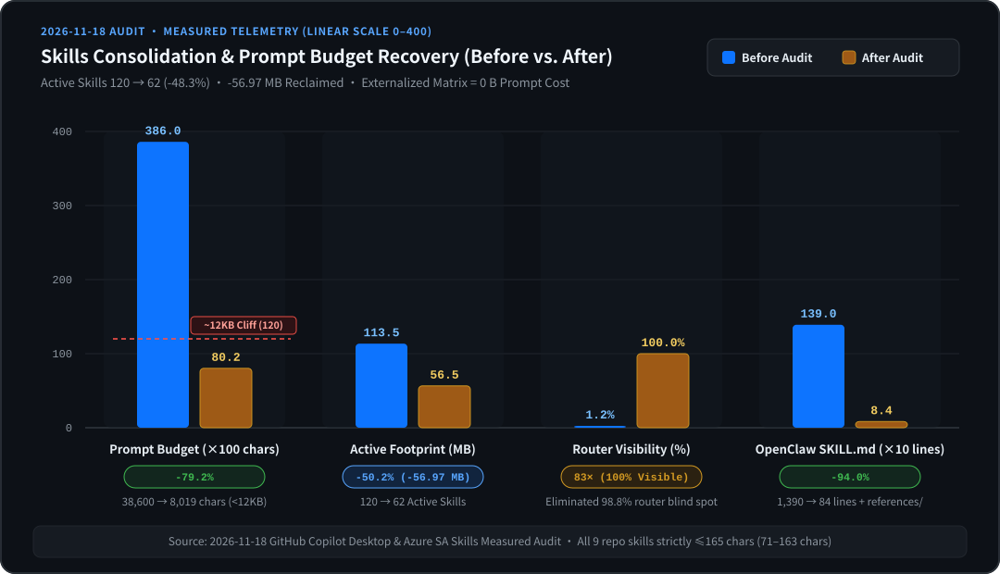
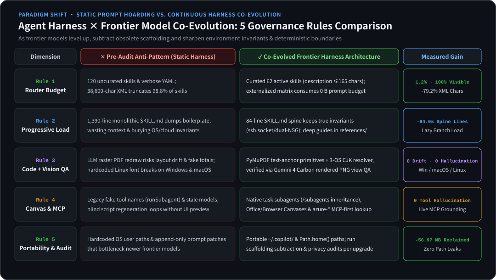
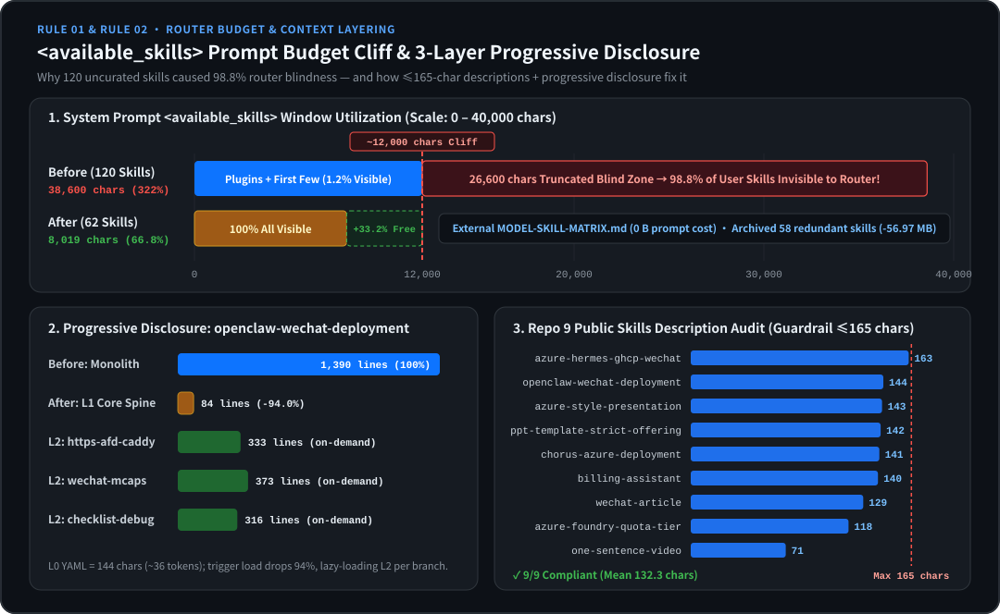
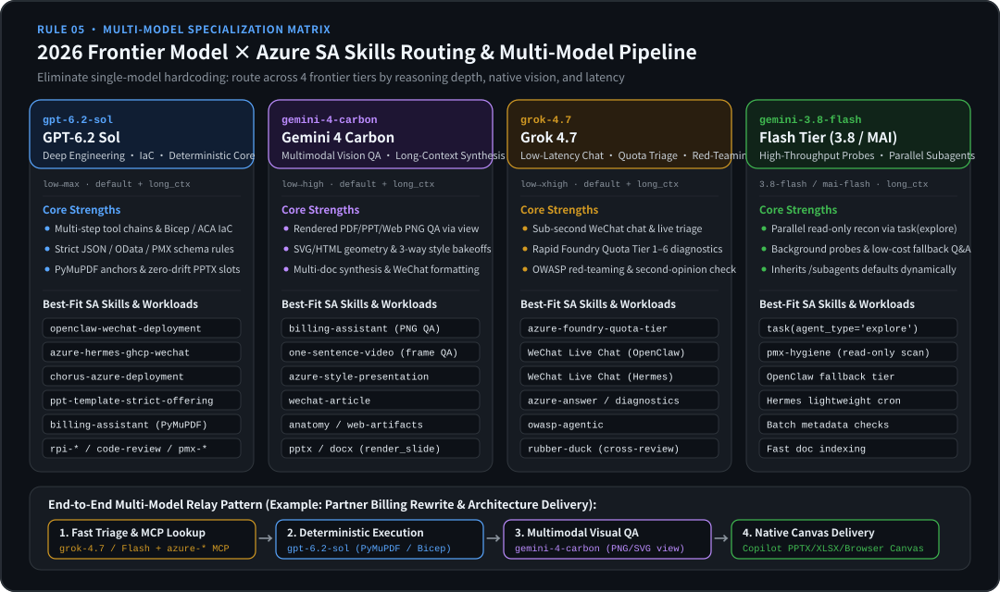
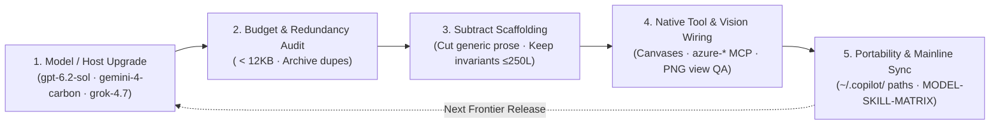

# Skill & Agent Harness Co-Evolution Governance Guide

> **中文版**: [`README.md`](./README.md) · **Routing Matrix & Authoring Checklist**: [`MODEL-SKILL-MATRIX.md`](./MODEL-SKILL-MATRIX.md)
> **Live Interactive Presenter Showcase**: [English (`index.en.html`)](https://turbo998.github.io/workshops/agent-harness-coevolution/index.en.html) · [中文版 (`index.html`)](https://turbo998.github.io/workshops/agent-harness-coevolution/index.html)
> **Full Research Monograph**: [`ai-research-public/docs/research/agent-harness-model-coevolution`](https://github.com/turbo998/ai-research-public/tree/main/docs/research/agent-harness-model-coevolution)

---

## Core Thesis: Why Frontier Model Upgrades Demand Harness Subtraction

Teams operating daily across GitHub Copilot, OpenClaw, and Hermes naturally fall into an **append-only skill accumulation trap**: prompt workarounds written for older models, 1,000+ line monolithic runbooks, duplicate framework copies, and hardcoded model IDs pile up inside `~/.copilot/skills/`.

Once frontier models advance to **`gpt-6.2-sol`**, **`gemini-4-carbon`**, and **`grok-4.7`**, an uncurated static harness causes two compounding failures:

1. **Silent Router Blindness**: The `<available_skills>` XML block injected into the system prompt enforces an effective `~12 KB` ceiling. Prior to our 2026-11-18 audit, **120 active skills** generated **`38,600` characters** of index metadata—silently truncating **98.8% of user skills** and leaving router visibility at just **`1.2%`**.
2. **Context Pollution & Capability Capping**: Frontier models already understand standard Linux, TLS, and Bash syntax natively and possess strong multimodal visual inspection. Dumping 1,400 lines of generic commands upfront—or forcing LLM raster redraws and legacy fake tool names—wastes attention budget and caps model performance.



| Measured Audit Metric (2026-11-18) | Before Audit | After Co-Evolution | Delta & Engineering Impact |
|---|---:|---:|---|
| **Active Skills Count** | `120` | **`62`** | **`-48.3%`** (58 duplicate/superseded skills moved to `~/.copilot/skills-archive/`) |
| **Active Directory Footprint** | `113.5 MB` | **`56.5 MB`** | **`-56.97 MB` (`-50.2%`)** reclaimed across local & synced workspaces |
| **`<available_skills>` XML Payload** | `38,600 chars` | **`8,019 chars`** | **`-79.2%`** (`66.8%` of `~12 KB` ceiling, leaving `33.2%` safe headroom) |
| **User Skill Router Visibility** | `1.2%` | **`100.0%`** | **`83×` recovery** — zero truncated active skills |
| **`openclaw-wechat-deployment` `SKILL.md`** | `1,390 lines` | **`84 lines`** | **`-94.0%`** upfront load via 3-layer progressive disclosure + `references/` |
| **Externalized Routing Matrix Cost** | Inside `skills/` | **`0 bytes`** | `~/.copilot/MODEL-SKILL-MATRIX.md` sits outside scan tree (`0` prompt tokens) |

---

## Five Practical Co-Evolution Governance Rules



### Rule 1: Guard the `<available_skills>` Router Budget (`≤165 chars` + Active Set Curation)

- **Root Cause**: Copilot concatenates built-in plugins, workspace skills, and `~/.copilot/skills/` YAML `description` strings into `<available_skills>`. Exceeding `~12,000` characters truncates everything past the cliff—meaning the model never even knows those skills exist.
- **Engineering Actions**:
  1. **Consolidate & Cold-Archive**: Deduplicate overlapping copies (e.g., redundant `hve-core` exports and retired one-off helpers) from `120 → 62` active skills (`-56.97 MB`), parking historical skills in `~/.copilot/skills-archive/` outside the active scanner.
  2. **Enforce a Strict `110–165` Character Description Budget**: Structure every frontmatter `description` as **`Core capability + WHEN trigger + NOT FOR boundary`** in `≤165` characters. All 9 public SA skills in this repository measure **`71–163` characters** (mean `132.3` chars).
  3. **Externalize Meta-Governance Docs (`0-byte` Prompt Cost)**: Keep cross-skill reference matrices (`~/.copilot/MODEL-SKILL-MATRIX.md`) outside `skills/` so human operators and skill authors can link to them at zero system-prompt cost.



---

### Rule 2: Enforce 3-Layer Progressive Disclosure (`SKILL.md ≤ 250 lines` + `references/`)

- **Case Study**: [`openclaw-wechat-deployment`](../../openclaw-wechat-deployment/SKILL.md)
- **Pre-Audit Failure Mode**: A single **`1,390`-line** `SKILL.md` mixed VM provisioning, SSH port hardening, Azure Front Door + WAF, Caddy self-signed TLS, WeChat QR pairing, MCAPS anti-deallocation Logic Apps, and full JSON templates into one file—burning thousands of tokens on every trigger while burying non-obvious OS/cloud traps.
- **Refactored 3-Layer Architecture**:
  - **Layer 0 — Router Index (`144 chars` / `~36 tokens`, always resident)**: Crisp frontmatter `description` for deterministic skill selection.
  - **Layer 1 — Core Spine & True Environment Invariants ([`SKILL.md`](../../openclaw-wechat-deployment/SKILL.md), `84 lines`, `-94.0%`)**: Retains only the model tier map, phase routing table, and **environment invariants a frontier model cannot infer from pretraining**:
    - Mirroring inbound ports on **both NIC NSG and Subnet NSG** in Azure;
    - Overriding Ubuntu 24.04's `ssh.socket` (`/etc/systemd/system/ssh.socket.d/override.conf`) instead of editing `sshd_config` alone;
    - Running GitHub Copilot device-code login inside an interactive TTY (`ssh -t`) and enabling `sudo loginctl enable-linger $USER`.
  - **Layer 2 — On-Demand Deep Runbooks ([`references/`](../../openclaw-wechat-deployment/references/))**:
    - [`https-afd-and-caddy.md`](../../openclaw-wechat-deployment/references/https-afd-and-caddy.md) (`333` lines) — loaded only for AFD + WAF or Caddy TLS setup;
    - [`wechat-resilience-and-mcaps.md`](../../openclaw-wechat-deployment/references/wechat-resilience-and-mcaps.md) (`373` lines) — loaded only for WeChat QR login and 4× daily MCAPS Logic App auto-start protection;
    - [`one-run-checklist-and-troubleshooting.md`](../../openclaw-wechat-deployment/references/one-run-checklist-and-troubleshooting.md) (`316` lines) — loaded only for full `openclaw.json` reference or error recovery.

---

### Rule 3: Pair Deterministic Code Primitives with Multimodal Vision QA

- **Case Studies**: [`billing-assistant`](../../billing-assistant/SKILL.md) ([`scripts/invoice_edit.py`](../../billing-assistant/scripts/invoice_edit.py)) & [`ppt-template-strict-offering`](../../ppt-template-strict-offering/SKILL.md)
- **Why Pure Generative Redraw Fails**: Rewriting financial invoices via LLM rasterization (`nano-pdf`) risks layout drift, font substitution, and hallucinated currency totals. Meanwhile, legacy scripts hardcoded Linux font paths (`/usr/share/fonts/truetype/wqy/wqy-zenhei.ttc`), breaking CJK glyph rendering on Windows and macOS workstations.
- **Co-Evolved Pattern (Deterministic Primitives × Multimodal Verification)**:
  1. **Zero-Coordinate Text-Anchor Primitives (`gpt-6.2-sol`)**: Locate fields dynamically via `page.search_for(...)` (`BILL TO`, `SUB TOTAL`, `PRODUCT DISCOUNTS`), run `strip_annotations()` first so sticky notes never survive `cover()`, and leave untouched regions **byte-identical**.
  2. **Cross-Platform CJK Font Auto-Resolution**: [`billing-assistant/scripts/invoice_edit.py`](../../billing-assistant/scripts/invoice_edit.py) resolves CJK fonts automatically across `INVOICE_EDIT_FONT` → Windows (`msyh.ttc` / `simhei.ttf`) → macOS (`PingFang.ttc`) → Linux (`wqy-zenhei.ttc` / `NotoSansCJK`).
  3. **Multimodal Rendered-PNG QA (`gemini-4-carbon`)**: Render modified first/last PDF pages to 150 DPI PNGs and inspect them via the native `view` tool to verify zero surviving yellow highlights, zero clipped `ATTN:` neighbors, and exact dual-currency totals before delivery.

---

### Rule 4: Align with Native Runtime Tools, Desktop Canvases & MCP Grounding

As agent hosts (GitHub Copilot Desktop / CLI, OpenClaw, Hermes) ship richer native primitives, older prompt workarounds turn into liabilities:

- **Eliminate Fake Tool Names & Hardcoded Model Lock-In**: Replace legacy `runSubagent` references or unmounted custom agent names with the native `task` tool (`explore`, `research`, `rubber-duck`, `general-purpose`, `code-review`, `task`). Omit hardcoded `model` overrides inside subagent prompts unless explicitly requested so runtime `/subagents` user preferences apply cleanly.
- **Prefer Native Copilot Desktop Canvases for Interactive Artifacts**:
  - Use built-in `powerpoint` (with `render_slide` SVG inspection), `excel` (with atomic `batch` formula/style updates), `word`, and `browser` canvases for interactive authoring and visual verification—reserving standalone Python/OOXML scripts for batch ETL or strict template slot surgery ([`ppt-template-strict-offering`](../../ppt-template-strict-offering/SKILL.md)).
- **MCP-First Factual Verification**: Load `azure-*` and `microsoft-learn-*` MCP tools via `tool_search_tool` for live Azure SKU, regional availability, quota, and pricing checks prior to generic web search.

---

### Rule 5: Route Across Specialized Frontier Model Tiers & Enforce Portability Hygiene

Frontier models exhibit distinct strengths across multi-step schema execution, visual spatial reasoning, and conversational latency. Co-evolving the harness means routing each SA workload to its highest-leverage tier:



- **Portable Path & Privacy Hygiene**:
  - Standardize every public and cross-machine skill on `~/.copilot/skills/`, `Path.home()`, or `$HOME`—never hardcoded OS usernames (`C:\Users\<username>\...`) or private tenant/customer identifiers.
- **Continuous Co-Evolution Audit Loop**: Run this lightweight subtraction cycle whenever a new frontier model cohort or host capability ships:



---

## 5-Second Local Budget Audit One-Liner

Run this cross-platform Python snippet to audit your active `~/.copilot/skills/` count, estimated `<available_skills>` XML character budget, and any descriptions exceeding the `165`-character guardrail:

```bash
python -c "import pathlib, re; root = pathlib.Path.home()/'.copilot'/'skills'; skills = sorted(root.glob('*/SKILL.md')); descs = [(p.parent.name, (re.search(r'^description:\s*[\"\x27]?(.*?)[\"\x27]?\s*$', p.read_text(encoding='utf-8', errors='ignore'), re.M) or ['', ''])[1]) for p in skills]; total = sum(len(n)+len(d)+65 for n,d in descs); over = [(n,len(d)) for n,d in descs if len(d)>165]; print(f'Active skills: {len(descs)} | Est. XML budget: {total:,} chars (~{total/12000*100:.1f}% of 12KB) | Over 165 chars: {len(over)}'); [print('  OVER:', n, c) for n,c in over]"
```

---

## Companion Resources

- **Interactive Visual Presenter Deck (Built for Engineering Tech Talks)**:
  - English: [https://turbo998.github.io/workshops/agent-harness-coevolution/index.en.html](https://turbo998.github.io/workshops/agent-harness-coevolution/index.en.html)
  - 中文版: [https://turbo998.github.io/workshops/agent-harness-coevolution/index.html](https://turbo998.github.io/workshops/agent-harness-coevolution/index.html)
- **Full Research Monograph (Framework & Industry Synthesis)**: [`turbo998/ai-research-public` — Agent Harness & Model Co-Evolution](https://github.com/turbo998/ai-research-public/tree/main/docs/research/agent-harness-model-coevolution)
- **Frontier Model × SA Skill Routing Matrix & Authoring Checklist**: [`MODEL-SKILL-MATRIX.md`](./MODEL-SKILL-MATRIX.md)
