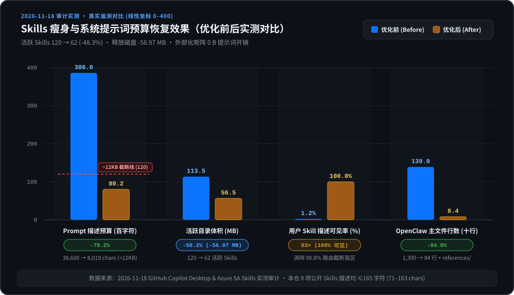
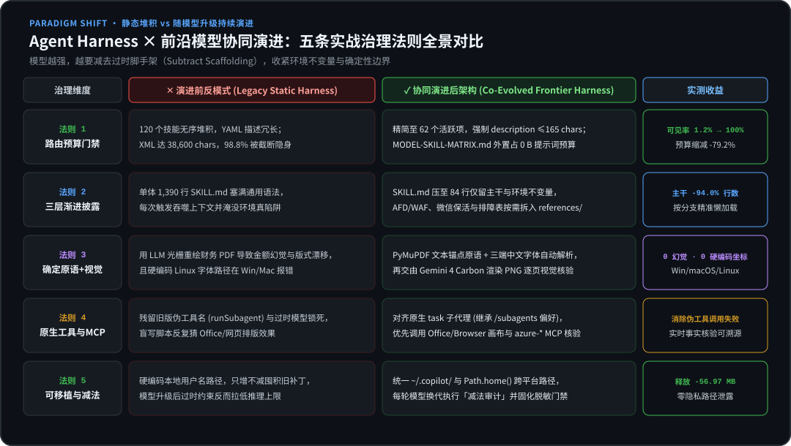
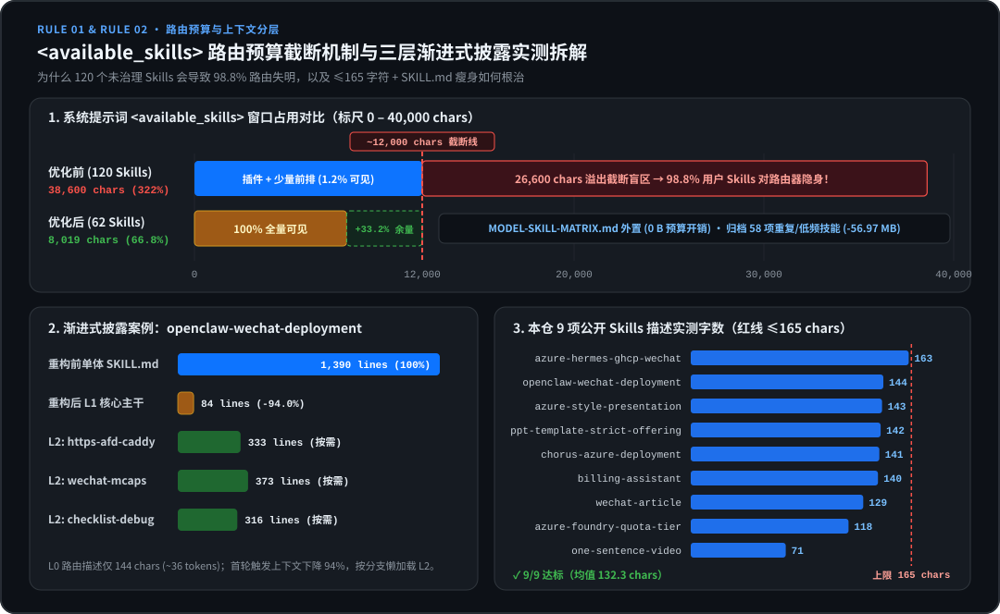
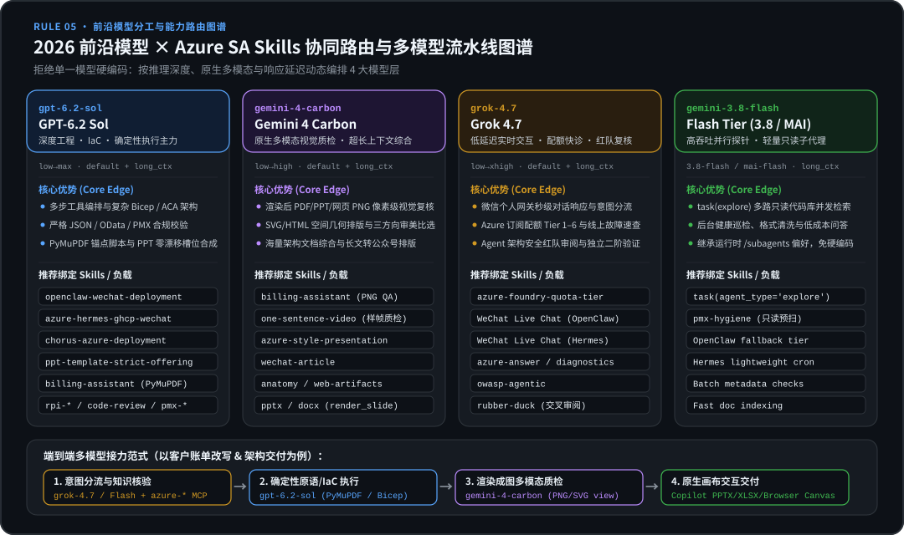
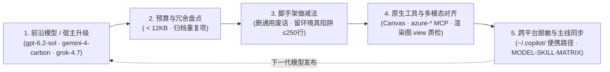

# Skill 与 Agent Harness 随模型升级的协同演进治理指南

> **English Version**: [`README.en.md`](./README.en.md) · **模型路由速查与编写清单**: [`MODEL-SKILL-MATRIX.md`](./MODEL-SKILL-MATRIX.md)
> **交互式技术宣讲演示页 (Live Showcase)**: [中文版 (`index.html`)](https://turbo998.github.io/workshops/agent-harness-coevolution/index.html) · [English (`index.en.html`)](https://turbo998.github.io/workshops/agent-harness-coevolution/index.en.html)
> **完整专题研究报告 (Monograph)**: [`ai-research-public/docs/research/agent-harness-model-coevolution`](https://github.com/turbo998/ai-research-public/tree/main/docs/research/agent-harness-model-coevolution)

---

## 核心命题：为什么模型升级后，必须同步做 Harness「减法与重构」？

在日常高频使用 GitHub Copilot、OpenClaw 与 Hermes 的过程中，工程团队极易陷入**「只增不减（Append-Only）」的技能堆积陷阱**：为上一代模型打过的提示词补丁、动辄上千行的单体部署手册、重复派生的技能目录与硬编码模型名被长期留在 `~/.copilot/skills/` 中。

当前沿模型升级至 **`gpt-6.2-sol`**、**`gemini-4-carbon`** 与 **`grok-4.7`** 后，这种静态臃肿的 Harness 会引发两类系统性退化：

1. **路由截断失明（Router Blindness）**：系统提示词中的 `<available_skills>` XML 预算存在约 `~12 KB` 截断上限。在 2026-11-18 实测审计前，本地堆积的 **120 个活跃 Skills** 产生了 **`38,600` 字符**的索引负载，导致 **98.8% 的用户自定义 Skills 被静默截断**（实际路由可见率仅 **`1.2%`**）。
2. **上下文淹没与能力压制（Scaffolding Overhead）**：前沿模型已原生掌握通用 Linux/Bash/TLS 语法与多模态视觉能力，但过时的千行单体文档与脆弱的旧工具调用（如光栅化重绘财务 PDF、伪造旧版子代理工具名）反而挤占推理注意力并限制模型上限。



| 审计核心指标（2026-11-18 实测） | 优化前 (Before) | 优化后 (After) | 变化幅度 / 工程收益 |
|---|---:|---:|---|
| **活跃 Skills 数量** | `120` | **`62`** | **`-48.3%`**（归档 58 项重复/低频与历史残留技能至 `~/.copilot/skills-archive/`） |
| **活跃目录磁盘体积** | `113.5 MB` | **`56.5 MB`** | **`-56.97 MB` (`-50.2%`)** 释放启动扫描与同步开销 |
| **`<available_skills>` XML 预算占用** | `38,600 chars` | **`8,019 chars`** | **`-79.2%`**（稳居 `~12 KB` 截断线以下，预留 `33.2%` 安全余量） |
| **用户 Skill 路由器可见率** | `1.2%` | **`100.0%`** | **`83×` 恢复至全量可见**，彻底消除路由盲区 |
| **`openclaw-wechat-deployment` 主干行数** | `1,390 lines` | **`84 lines`** | **`-94.0%`**（拆分为 L1 不变量主干 + 3 份按需 `references/`） |
| **外部化模型路由矩阵提示词开销** | 混入 `skills/` | **`0 bytes`** | `~/.copilot/MODEL-SKILL-MATRIX.md` 移出扫描树，零预算损耗 |

---

## 五条实战协同演进法则（5 Proven Co-Evolution Rules）



### 法则 1：严守 `<available_skills>` 路由预算门禁（`≤165 chars` + 归档去重）

- **问题根因**：Copilot 会将内置插件、工作区技能与 `~/.copilot/skills/` 的 YAML `description` 拼接进 `<available_skills>`。一旦总长度突破 `~12,000` 字符，排在后方的自定义技能对模型路由器完全不可见。
- **治理动作**：
  1. **合并与冷归档**：清理重复的框架副本（如多份 `hve-core` 冗余拷贝与一次性脚本），将活跃集合从 `120` 收敛至 `62`（释放 `-56.97 MB`），低频资产移入不参与扫描的 `~/.copilot/skills-archive/`。
  2. **描述字数红线（`110–165` 字符）**：每条 `SKILL.md` 的 `description` 严格遵循 **`核心能力 + 触发时机 (WHEN) + 排除边界 (NOT FOR)`** 浓缩公式，上限 **`≤165` 字符**。本仓库公开的 9 项 SA Skills 描述长度实测均在 **`71–163` 字符**之间（均值 `132.3` 字符）。
  3. **治理文档零预算外置**：跨技能参考规范（如 `~/.copilot/MODEL-SKILL-MATRIX.md`）置于 `skills/` 目录之外，消耗 **`0 bytes`** 系统提示词预算。



---

### 法则 2：实施三层渐进式披露（`SKILL.md ≤ 250 行` + `references/` 按需加载）

- **典型案例**：[`openclaw-wechat-deployment`](../../openclaw-wechat-deployment/SKILL.md)
- **重构前痛点**：单个 `SKILL.md` 长达 **`1,390` 行**，把 Azure VM 创建、SSH 改端口、AFD+WAF、Caddy 自签证书、微信扫码、MCAPS 防回收 Logic App 与完整 JSON 配置全部平铺。每次触发不仅浪费数千输入 Token，还容易让模型漏掉真正致命的环境陷阱。
- **重构后三层架构**：
  - **L0 路由索引层（常驻系统提示词，`144 chars` / `~36 tokens`）**：仅声明部署目标、模型栈与网关能力，确保 100% 精准命中。
  - **L1 核心主干与环境不变量层（[`SKILL.md`](../../openclaw-wechat-deployment/SKILL.md)，`84 lines`，缩减 `-94.0%`）**：只保留模型分层表、架构映射表与**通用训练语料无法猜到的环境真陷阱**：
    - Azure VM 必须**同时检查 NIC NSG 与 Subnet NSG** 并双向放行规则；
    - Ubuntu 24.04 默认启用 `ssh.socket`，仅改 `sshd_config` 无效，必须写入 `/etc/systemd/system/ssh.socket.d/override.conf`；
    - GitHub Copilot 设备码登录必须分配交互式伪终端（`ssh -t`），守护进程必须开启 `sudo loginctl enable-linger $USER`。
  - **L2 按需深水区参考层（[`references/`](../../openclaw-wechat-deployment/references/)）**：
    - [`https-afd-and-caddy.md`](../../openclaw-wechat-deployment/references/https-afd-and-caddy.md)（`333` 行）：仅在配置 Azure Front Door + WAF 或 Caddy TLS 时读取；
    - [`wechat-resilience-and-mcaps.md`](../../openclaw-wechat-deployment/references/wechat-resilience-and-mcaps.md)（`373` 行）：仅在接入微信插件与配置 MCAPS 每日 4 次自动拉起护栏时读取；
    - [`one-run-checklist-and-troubleshooting.md`](../../openclaw-wechat-deployment/references/one-run-checklist-and-troubleshooting.md)（`316` 行）：仅在一键联调或排障时按需查阅。

---

### 法则 3：确定性代码原语 + 原生多模态视觉质检（零硬编码坐标、零金额幻觉）

- **典型案例**：[`billing-assistant`](../../billing-assistant/SKILL.md)（[`scripts/invoice_edit.py`](../../billing-assistant/scripts/invoice_edit.py)）与 [`ppt-template-strict-offering`](../../ppt-template-strict-offering/SKILL.md)
- **为什么不能全靠生成式重绘**：合作伙伴财务账单改写若采用 `nano-pdf` 等光栅化重绘方案，LLM 会重新生成整页像素，极易引发字体漂移与汇总金额幻觉；而早期脚本将中文字体硬编码为 Linux 路径 `/usr/share/fonts/truetype/wqy/wqy-zenhei.ttc`，在 Windows 或 macOS 工作站上直接报错或出现中文空白方块。
- **协同演进范式（Code Execution × Multimodal Verification）**：
  1. **确定性文本锚点原语（`gpt-6.2-sol` 编排）**：通过 `page.search_for(...)` 动态定位 `BILL TO`、`SUB TOTAL` 等锚点，执行 `strip_annotations()` 剥除黄色批注图层 + 局部白底覆盖重印，未触碰区域保持 **100% 字节级一致**。
  2. **跨平台中文字体自动解析**：在 [`billing-assistant/scripts/invoice_edit.py`](../../billing-assistant/scripts/invoice_edit.py) 中实现 `_resolve_cjk_font()`，按 `INVOICE_EDIT_FONT` 环境变量 → Windows (`msyh.ttc` / `simhei.ttf`) → macOS (`PingFang.ttc`) → Linux (`wqy-zenhei.ttc` / `NotoSansCJK`) 顺序自动回退。
  3. **原生多模态闭环验收（`gemini-4-carbon` 视觉复核）**：将改后 PDF 首页与末页渲染为 150 DPI PNG，调用原生 `view` 工具执行多模态视觉质检，确认无残留高亮气泡、无遮挡邻近 `ATTN:` 行、双币种金额对齐无误后再交付。

---

### 法则 4：对齐宿主原生工具、Desktop Canvas 与 MCP 事实核验（清除伪脚手架）

随着宿主运行时（GitHub Copilot Desktop / CLI、OpenClaw、Hermes）演进，许多早期手工拼凑的提示词绕行方案已成为负资产：

- **清理旧版伪工具名与硬编码模型锁死**：全面移除遗留的 `runSubagent` 或未挂载的私有代理名，统一对齐宿主原生 `task` 子代理（`explore`、`research`、`rubber-duck`、`general-purpose`、`code-review`、`task`），并**默认省略子代理硬编码 `model` 参数**，让运行时 `/subagents` 用户偏好自动解析生效。
- **优先使用原生交互式画布（Copilot Desktop Canvases）**：
  - 处理 Office 文档与前端界面时，优先打开内置 `powerpoint`（支持 `render_slide` 直接返回单页 SVG 供视觉自检）、`excel`（支持 `batch` 原子写入公式与格式）、`word` 与 `browser` 画布，告别「盲写脚本 → 导出报错 → 反复盲猜排版」的低效循环；仅在批量 ETL 或严格母版槽位替换（如 [`ppt-template-strict-offering`](../../ppt-template-strict-offering/SKILL.md)）时下沉至确定性脚本。
- **MCP-First 事实溯源**：涉及 Azure SKU、区域可用性、订阅配额与官方架构规范时，先通过 `tool_search_tool` 按需加载 `azure-*` 与 `microsoft-learn-*` MCP 工具读取实时权威数据，杜绝凭记忆猜测配额或价格。

---

### 法则 5：面向 2026 前沿模型矩阵动态分工，固化跨平台脱敏卫生门禁

不同前沿模型在推理深度、多模态空间感知与首字延迟上各有擅长。将所有 Skill 锁死在单一旧模型上既浪费算力又错失新能力：



- **跨平台路径与隐私脱敏门禁**：
  - 所有公开与跨机同步的 `SKILL.md` 及脚本一律使用 `~/.copilot/skills/`、`Path.home()` 或 `$HOME`，严禁残留本地操作系统用户名路径（如 `C:\Users\<username>\...`）或真实订阅/客户标识。
- **持续演进闭环（Co-Evolution Loop）**：每当新模型代际上线或宿主新增原生工具时，按以下闭环执行一次轻量治理审计：



---

## 快速自检命令（5 秒复现本地预算审计）

在任意终端运行以下 Python 单行脚本，即可一键测量当前 `~/.copilot/skills/` 的活跃技能数、总 `<available_skills>` 描述预算与超标项（`>165 chars`）：

```bash
python -c "import pathlib, re; root = pathlib.Path.home()/'.copilot'/'skills'; skills = sorted(root.glob('*/SKILL.md')); descs = [(p.parent.name, (re.search(r'^description:\s*[\"\x27]?(.*?)[\"\x27]?\s*$', p.read_text(encoding='utf-8', errors='ignore'), re.M) or ['', ''])[1]) for p in skills]; total = sum(len(n)+len(d)+65 for n,d in descs); over = [(n,len(d)) for n,d in descs if len(d)>165]; print(f'Active skills: {len(descs)} | Est. XML budget: {total:,} chars (~{total/12000*100:.1f}% of 12KB) | Over 165 chars: {len(over)}'); [print('  OVER:', n, c) for n,c in over]"
```

---

## 延伸阅读与配套资源

- **交互式图文宣讲报告（适合技术团队内部分享展示）**：
  - 中文版：[https://turbo998.github.io/workshops/agent-harness-coevolution/index.html](https://turbo998.github.io/workshops/agent-harness-coevolution/index.html)
  - English: [https://turbo998.github.io/workshops/agent-harness-coevolution/index.en.html](https://turbo998.github.io/workshops/agent-harness-coevolution/index.en.html)
- **深度研究长文（理论框架与业界对标）**：[`turbo998/ai-research-public` — Agent Harness & Model Co-Evolution](https://github.com/turbo998/ai-research-public/tree/main/docs/research/agent-harness-model-coevolution)
- **模型 × Skill 路由速查表与编写规范清单**：[`MODEL-SKILL-MATRIX.md`](./MODEL-SKILL-MATRIX.md)
